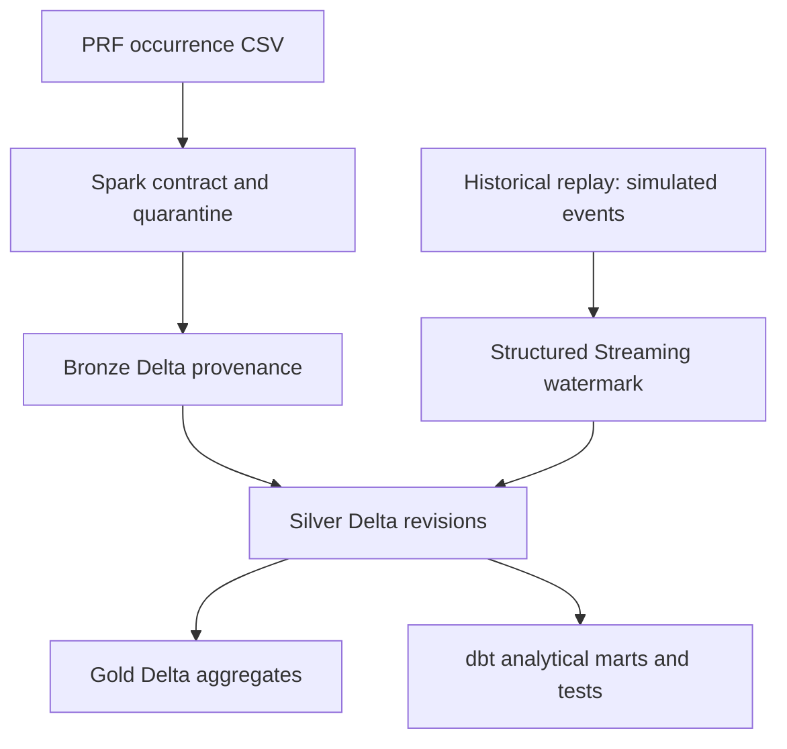

# Ceará Road Safety Lakehouse Pro

Process federal highway accident data with Spark and Delta Lake, from ingestion and quarantine through dbt checks and monitored orchestration.

**Local evidence.** 73,201 accepted records, one quarantined row, seven passing dbt checks, and a delivered local quarantine alert. [Airflow run](evidence/airflow-pro-20261106/mac-run/result.json) · [Alert delivery](evidence/observability-20261109/mac-run/result.json).

Based on [ceara-road-safety-data-platform](https://github.com/VictorCPena/ceara-road-safety-data-platform/tree/c41ca1e746b62786b4dbe77daff97ada3b9dac20).

## 1. Problem Statement

Build auditable road-safety datasets from public Brazilian Federal Highway Police (PRF) records. National records form the engineering workload; Ceará is an analytical filter. Missing accident keys are quarantined rather than fabricated. The original PRF/IBGE/weather product marts and dashboard are preserved.

## 2. Architecture



Two executed writers exist: `lakehouse.core` uses Spark transformation and delta-rs transactions through a bounded local Pandas boundary; `lakehouse.spark_delta` executes native Spark/Delta writes and MERGE without collecting the primary dataset. The former supports the tested local streaming sink. These paths use **separate roots**. Do not point both at a shared writer directory.

## 3. Tech Stack

Python, Spark 3.5.8, native Delta Lake 3.2.1, delta-rs, DuckDB, dbt. Redpanda/Kafka adapters, Airflow DAGs, PostgreSQL metadata configuration, Terraform and Prometheus alert rules are delivered with explicit execution limits. Databricks and cloud services were not provisioned.

## 4. Dataset & Data Provenance

Source: [PRF open data](https://www.gov.br/prf/pt-br/acesso-a-informacao/dados-abertos/dados-abertos-da-prf). The download recipe resolves the official 2024 occurrence ZIP. The executed CSV fingerprint is `7d26e6f4528c2ca2636a8fea2c5bc8755a0ff6a182d82c238a8793b016e4366d`. Of 73,202 rows, 73,201 passed and one lacked a valid accident ID. No missing ID was invented. Source updates may change hashes; compare manifests before interpreting reruns. Public open-data reuse is described by PRF; upstream terms and attribution remain applicable. No personal identity table is ingested.

## 5. Setup & Installation

Python 3.12 compatibility: `setuptools==84.2.1` is an explicit runtime dependency
because this pinned PySpark version imports `distutils.version.LooseVersion`
during Pandas conversion. Fresh Python 3.12 virtual environments do not include
setuptools by default. A missing dependency caused all five tests to fail in a
user-reported Intel Mac run; the import/comparison fix was checked on Linux with
Python 3.12.14. The user subsequently reported all five Spark tests passing on
Intel Mac/Python 3.12.13/Java 17 (43.28 s), followed by successful PRF batch,
native Delta replay and dbt execution (3 models and 7 data tests).

To repair an existing project environment:

```bash
python -m pip install "setuptools==84.2.1"
python -c "from distutils.version import LooseVersion; print('distutils import OK')"
python -m pytest tests/test_pro_lakehouse.py -q
```

Run the commands below from the repository root with Python 3.12 and Java 17. The Spark batch was exercised on Linux x86_64 and Intel macOS.

```bash
PYTHON_BIN=python3.12 bash scripts/setup.sh
source .venv/bin/activate
```

Direct dependencies are pinned in `requirements-portfolio.txt`. See `requirements-lock.txt` for the Linux dependency snapshot. Initial access to public data and Spark connector JARs requires internet access.

Java 17 is also required. Native Delta jars are fetched from Maven Central by `lakehouse.spark_delta` and kept in `work/jars`. The Spark Kafka source additionally needs `org.apache.spark:spark-sql-kafka-0-10_2.12:3.5.8`.

## 6. Running Locally

```bash
python -m lakehouse.demo
python -m lakehouse.spark_delta --csv data/raw/datatran2024.csv
dbt build --project-dir dbt_lakehouse --profiles-dir dbt_lakehouse
python -m lakehouse.benchmark
```

Use `--csv /path/to/datatran2024.csv` to avoid downloading. `lakehouse.demo` writes `work/lakehouse`; the native path writes `work/native_delta`. Gold exports feed `dbt_lakehouse`. Original analytical marts remain under `analytics`, with instructions preserved in `docs/README_ORIGINAL.md`.

For the original Airflow Compose stack, run `python scripts/create_local_env.py` once. It creates ignored random secrets and refuses overwrite. The new profile uses `compose.airflow-pro.yaml` and `Dockerfile.airflow-pro`; see [AIRFLOW_PRO.md](AIRFLOW_PRO.md). The DAG ran successfully with Airflow 3.3.2, SQLite and a synthetic fixture (two tasks, three models, seven dbt tests). Five additional tests passed. The user subsequently validated the Docker image and PostgreSQL deployment on Intel Mac: authenticated REST trigger, scheduler/LocalExecutor, both tasks successful and cross-layer data validation passed (73,201 accepted, one quarantined, three models, seven dbt tests). The reported run/verification duration was 159.46772988299927 s; this is not a throughput benchmark. Evidence: `evidence/airflow-pro-20261106/mac-run/`. The original stack is preserved. `compose.portfolio.yaml` defines a separate local Redpanda broker. Kafka producer `lakehouse.streaming.produce` and consumer `run_stream(..., kafka=True)` are implemented. The user subsequently supplied a passing local Kafka-to-Spark run on Intel Mac; see `VALIDACAO_KAFKA.md`.

Local observability uses a separate Compose profile. It reads completed Airflow reports from the existing work volume, exposes Prometheus metrics and provisions a Grafana dashboard. Alertmanager sends notifications to a local HTTP receiver. Four Python tests and an HTTP export check against the previously captured real report passed. The user subsequently validated Compose on the Mac, including promtool rule tests, Prometheus scraping, the Grafana dashboard and datasource query, and Alertmanager webhook delivery for one real quarantined row. See the captured result in `evidence/observability-20261109/mac-run/`. See [OBSERVABILIDADE.md](OBSERVABILIDADE.md).

The user validated the Terraform configuration on the Mac with the `hashicorp/terraform:1.11.4` Docker image and AWS provider 5.100.0. Formatting, initialization with the locked provider, and `terraform validate -json` passed. The result and command provenance are in `evidence/terraform-mac-20261109/`. This check covers the local configuration. AWS planning and provisioning remain outside this run.

## 7. Testing

Kafka validation update (November 6): the user started Redpanda through Colima
on Intel Mac and verified broker metadata from Python. This initially verified connectivity. The user subsequently supplied the full passing Kafka/Spark run: 9 source/Silver rows, one DLQ record, controlled failure recovery and 8 live Gold accidents; the extracted results are retained in `evidence/kafka-validation-20261106/mac-user-run/`. See [VALIDACAO_KAFKA.md](VALIDACAO_KAFKA.md) for
`python -m lakehouse.kafka_validation`: a bounded replay with an exclusive
topic/root, duplicate/DLQ checks and controlled post-commit failure/recovery.
Its broker execution passed on the user's Mac, including all 10 runner checks. The file-source recovery and startup cleanup
tests passed locally: 7 tests including the original 5. A UTC process timezone
was required in this Linux environment; logs retain the initial failed baseline.

```bash
python -m pytest tests/test_pro_lakehouse.py -q
python -m ruff check lakehouse tests/test_pro_lakehouse.py
```

Integration tests execute Spark, Delta transactions, replay, an injected failure after Silver commit, recovery, committed revision conflicts, tombstones, physical delete/time travel, streaming duplicate messages, invalid-envelope DLQ, persistent checkpoints and late-event exclusion. Original dbt fixture build: 19 models and 128 data tests passed; upgraded real-data dbt build: 3 models and 7 tests passed. Fixtures are labeled fixtures, not national data.

## 8. Performance Results

Native Spark/Delta executed 73,201 accepted rows in 27.06 seconds including writes, replay and transaction demonstration. Isolated aggregation medians:

|   rows | engine   |   seconds |
|-------:|:---------|----------:|
|  73201 | duckdb   |    0.0741 |
|  73201 | pandas   |    0.0585 |
|  73201 | spark    |    6.2386 |
| 292804 | duckdb   |    0.0701 |
| 292804 | pandas   |    0.1458 |
| 292804 | spark    |    7.1988 |

Three repetitions per engine/volume; Spark startup included; filesystem cache not flushed. The 4× workload repeats real rows and is a stress workload, not extra independent observations. See the [aggregation benchmark chart](evidence/engine_benchmarks.png) and [individual runs](evidence/benchmark.json) for timing and partition-pruning results. Process-tree memory was inaccessible; runtime high-water reports are retained with caveats and are not proof of engine memory superiority. No multi-node scaling or cloud cost benchmark was performed.

## 9. Engineering Decisions

- Immutable Bronze row fingerprints; source revision controls Silver updates.
- Same key/revision with different payload is an error. A higher revision is required.
- Deletes use persistent tombstones in the streaming/current-state path, preventing older replays from resurrecting rows. Physical delete is demonstrated separately and must not replace the tombstone ledger.
- UF partitions support geographic scans; 27 small files are acceptable for this demonstration but should be compacted/reconsidered at other scales.
- PRF timestamps retain source wall time under a fixed session convention; no nationwide UTC conversion is claimed. Replay must use the same convention.
- Local writers are serialized with a file lock. This is not a distributed lock.
- Cross-layer writes are not atomic. Repeating a run repairs Gold from committed Silver.

## 10. Failure Handling

`last_success.json` is written after Gold; `last_failure.json` records a subsequent failed run. Check both, never treat an old success marker as current success. Checkpoints track source progress; the Delta merge is replay-idempotent. `foreachBatch` has at-least-once execution with idempotent sink effects, not a global exactly-once guarantee. A two-day event-time watermark bounds duplicate state. Events older than that horizon may be dropped and need batch reconciliation. Malformed envelopes enter a file DLQ; conflicting committed revisions fail the batch for investigation. Source retention and Kafka offsets must also remain available.

## 11. Limitations

The delta-rs sink collects each micro-batch into driver memory and is limited to local demonstration volumes. Native Spark/Delta has been executed on one machine only. Broker outage recovery, Airflow/PostgreSQL crashes during active tasks, External notification integrations and cloud apply remain outside the validated scope. The monitoring profile includes an exporter, dashboard, rules and a local webhook receiver. The user validated one local quarantine notification via Compose. Categorical municipality matching, IBGE and weather enhancements are inherited and fixture-tested, not re-ingested at national scale in this run.

Generate Airflow credentials with the documented setup script and keep the resulting environment file local.

## 12. Future Improvements

Validate broker failure/rebalance and offset-retention recovery; test Airflow worker and PostgreSQL interruptions during active tasks; implement distributed streaming Delta merges; test larger independent workloads; validate cloud IAM/IaC in a separately authorized sandbox. See the explicit backlog rather than assuming these capabilities exist.

Scheduled scheduler restart verification (user-supplied Mac evidence, November 6):
run `portfolio_20261106T214640_559df1a9` passed both tasks and all data checks,
with unchanged source hash and counts after a planned restart. The reported
run/verification duration was 128.0716736029999 s; no controlled performance
comparison is claimed. See `evidence/airflow-pro-20261106/mac-scheduler-restart/`.
A crash during an active task, database/API restart and HA remain untested.

## Legacy analytics profile

The historical dashboard and dbt models remain in [the original guide](docs/README_ORIGINAL.md).
Download the municipality map with `python scripts/download_ceara_geojson.py`. To exercise the legacy
dbt CI step locally, generate the fixtures with `python scripts/create_ci_fixtures.py` after ingesting
the Silver inputs. The GitHub snapshot excludes source-derived fixtures. The legacy dbt step checks
for those files before running. The main Python suite uses synthetic inputs.
